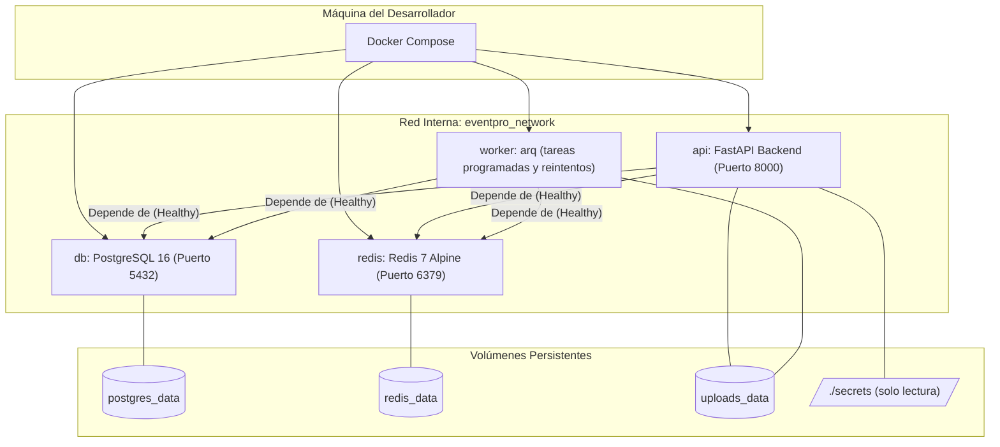

# 02. Docker e Infraestructura de Desarrollo Local

---

## 1. Arquitectura de Contenedores Local

Para garantizar la reproducibilidad absoluta del entorno de desarrollo sin conflictos de dependencias en Windows, Linux o macOS, la infraestructura local de EventPro se orquesta mediante **Docker Compose**.



> [!NOTE]
> El diagrama muestra el núcleo de EventPro. Chatwoot (gateway de WhatsApp) y el proxy HTTPS del servidor se agregan con archivos Compose opcionales; ver la sección 4.

---

## 2. Servicios, Volúmenes y Salud

| Servicio | Imagen | Función | Verificación de salud |
| :--- | :--- | :--- | :--- |
| `api` | `Dockerfile` (etapa `runner`) | FastAPI con `uvicorn app.main:app` (sin `--reload`) | `HEALTHCHECK` de la imagen: `GET /health` con la biblioteca estándar de Python |
| `worker` | La misma imagen | `arq app.infrastructure.adapters.primary.jobs.worker.WorkerSettings` (ADR-08) | Ninguna propia; depende de `db` y `redis` sanos |
| `db` | `postgres:16-alpine` | PostgreSQL | `pg_isready` |
| `redis` | `redis:7-alpine` | Caché, locks y cola de tareas | `redis-cli ping` |

* **Orden de arranque:** `api` y `worker` esperan a que `db` y `redis` estén `service_healthy`.
* **Volúmenes:** `postgres_data`, `redis_data` y `uploads_data` (comprobantes y contratos en `/app/uploads`, compartido por `api` y `worker`).
* **Certificado de firma:** `./secrets` se monta en `/run/secrets` en solo lectura; la variable `SIGNATURE_PKCS12_PATH` apunta a `/run/secrets/eventpro-signing.p12`.
* **Imagen:** multi-etapa, instala solo `requirements.txt` y ejecuta como usuario sin privilegios `eventpro` (UID 10001), propietario de `/app/uploads`.
* **Puertos:** PostgreSQL y Redis se publican solo en `127.0.0.1`.

### 2.1 Modo desarrollo y modo producción

`docker-compose.override.yml` se aplica automáticamente con `docker compose up` y activa la recarga en caliente (`uvicorn --reload`, `arq --watch`) con el código `./app` montado desde el host. Para ejecutar con la configuración base, sin override (producción o staging):

```bash
docker compose -f docker-compose.yml up -d --build
```

---

## 3. Comandos Operativos Clave

### 3.1 Levantar Infraestructura Completa
```bash
docker compose up -d --build
```

### 3.2 Verificación de Estado y Logs
```bash
docker compose ps
docker compose logs -f api worker
curl -s http://localhost:8000/health
```

### 3.3 Ejecutar Migraciones de Base de Datos
```bash
docker compose exec api alembic upgrade head
```

### 3.4 Cargar Datos Semilla (Seeds de Catálogo y Roles)
```bash
docker compose exec api python -m app.infrastructure.adapters.secondary.persistence.seed
```

### 3.5 Crear el Primer Usuario `SUPERADMIN`
```bash
docker compose exec -e SUPERADMIN_EMAIL=admin@eventpro.pe -e SUPERADMIN_PASSWORD='<contraseña-segura>' api \
  python -m app.infrastructure.adapters.secondary.persistence.bootstrap_superadmin
```
Detalle en [Estrategia de Migraciones y Seeds, sección 4](../03-datos/03-estrategia-migraciones-y-seeds.md#4-comando-de-arranque-del-usuario-superadmin).

### 3.6 Ejecutar la Suite de Pruebas Automatizadas
```bash
python3.12 -m venv .venv && source .venv/bin/activate
pip install -r requirements-dev.txt
pytest -v --cov=app
```
Las herramientas de prueba y calidad no forman parte de la imagen de runtime (solo `requirements.txt`), por lo que la suite se ejecuta en un entorno virtual local. Las pruebas de integración usan PostgreSQL temporal mediante Testcontainers y requieren Docker en ejecución.

---

## 4. Archivos Compose y Combinaciones

La infraestructura se reparte en tres archivos (ver [Especificación del gateway, sección 6.3](../02-arquitectura/05-spec-chatwoot-gateway.md#63-archivos-compose)). Todos comparten la red `eventpro_network`.

| Archivo | Servicios | Uso |
| :--- | :--- | :--- |
| `docker-compose.yml` | `api`, `worker`, `db`, `redis` | Siempre. |
| `docker-compose.chatwoot.yml` | `chatwoot-rails`, `chatwoot-sidekiq`, `chatwoot-db` (`pgvector/pgvector:pg16`), `chatwoot-redis` | Opcional en desarrollo; obligatorio en el servidor. Chatwoot usa su propia base de datos y su propio Redis. |
| `docker-compose.proxy.yml` | `caddy` | Solo en el servidor (ver `deploy/Caddyfile`). |

| Escenario | Comando |
| :--- | :--- |
| Local sin Chatwoot (con recarga en caliente) | `docker compose up -d --build` |
| Local con Chatwoot | `docker compose -f docker-compose.yml -f docker-compose.override.yml -f docker-compose.chatwoot.yml up -d --build` |
| Servidor (con proxy, sin override de desarrollo) | `docker compose -f docker-compose.yml -f docker-compose.chatwoot.yml -f docker-compose.proxy.yml up -d --build` |

* Al especificar `-f` explícitamente, Compose deja de aplicar `docker-compose.override.yml` automáticamente; por eso aparece de forma explícita en el escenario local con Chatwoot.
* Requisitos previos de Chatwoot: copiar `chatwoot.env.example` a `chatwoot.env` y completar los secretos (ver [guía de entorno, sección 2.4.1](01-guia-entorno-y-configuracion.md#241-configuración-de-chatwoot-chatwootenv-y-del-proxy)).
* La imagen de Chatwoot está fijada a una versión concreta (`chatwoot/chatwoot:v4.18.0` al redactar este documento). Para actualizar, se cambia la versión y se ejecuta de nuevo la preparación de la base de datos (sección 5.1).
* **Puertos:** `chatwoot-rails` solo publica `127.0.0.1:3001` (configurable con `CHATWOOT_LOCAL_PORT`) para la administración local; el 3001 evita chocar con el frontend. En el servidor, `docker-compose.proxy.yml` retira además la publicación del puerto 8000 de `api`, de modo que la API solo se alcanza a través de Caddy.
* **Memoria estimada:** Chatwoot ~4 GB y EventPro ~1.5 GB (Caddy marginal). Un equipo de desarrollo necesita al menos 8 GB libres para levantar ambos.

---

## 5. Chatwoot: Primera Configuración

Se hace una sola vez por entorno. Las pantallas de Chatwoot pueden variar entre versiones; los puntos marcados en la [especificación, sección 9](../02-arquitectura/05-spec-chatwoot-gateway.md#9-verificaciones-pendientes-durante-la-implementación) se confirman durante la implementación.

### 5.1 Preparar la base de datos y arrancar

```bash
cp chatwoot.env.example chatwoot.env      # completar SECRET_KEY_BASE, POSTGRES_PASSWORD y REDIS_PASSWORD
docker compose -f docker-compose.yml -f docker-compose.chatwoot.yml up -d chatwoot-db chatwoot-redis
docker compose -f docker-compose.yml -f docker-compose.chatwoot.yml run --rm chatwoot-rails bundle exec rails db:chatwoot_prepare
docker compose -f docker-compose.yml -f docker-compose.chatwoot.yml up -d chatwoot-rails chatwoot-sidekiq
```

Este comando también se ejecuta tras cada cambio de versión de la imagen, para aplicar migraciones.

### 5.2 Cuenta y administrador

Con `ENABLE_ACCOUNT_SIGNUP=false` no existe registro público. En una instalación nueva, abrir `http://localhost:3001` en desarrollo (en el servidor, el acceso descrito en la sección 7, paso 8) muestra el asistente de instalación para crear el primer administrador y la cuenta de EventPro. Anotar el identificador de la cuenta (`CHATWOOT_ACCOUNT_ID`, visible en la URL `/app/accounts/<id>/...`).

### 5.3 Bandeja de WhatsApp Cloud

1. *Settings → Inboxes → Add Inbox → WhatsApp → WhatsApp Cloud*.
2. Completar con los datos del número de prueba de Meta: número de teléfono, *Phone number ID*, *WhatsApp Business Account ID* y el **token permanente de un *system user*** de Meta. No usar el token temporal del número de prueba (expira en aproximadamente 24 h).
3. Chatwoot muestra la **URL de devolución de llamada** (con la forma `https://<host-publico>/webhooks/whatsapp/<numero>`) y el **token de verificación**. Registrarlos en Meta for Developers (*WhatsApp → Configuration → Webhook*) y suscribir el campo `messages`.
   * En Chatwoot v4.18.0, el asistente de conexión manual intenta registrar el webhook en Meta por su cuenta. Si la aplicación de Meta aún no tiene un webhook configurado, ese intento falla con el error `(#100) Before override the current callback uri, your app must be subscribed to receive messages for WhatsApp Business Account`. El error no impide crear la bandeja: basta con terminar el asistente y registrar el webhook manualmente en Meta como se indica en este paso.
   * Si el asistente no muestra el token de verificación, se consulta en la configuración de la bandeja (*Settings → Inboxes → bandeja de WhatsApp → Configuration*).
   * Comprobación: enviar un mensaje de WhatsApp al número de prueba desde un destinatario registrado; debe aparecer como conversación en Chatwoot, y la respuesta enviada desde Chatwoot debe llegar al teléfono.
4. Anotar el identificador de la bandeja (`CHATWOOT_INBOX_ID`).
5. **Activar `lock_to_single_conversation`** en la configuración de la bandeja (*Settings → Inboxes → bandeja de WhatsApp → Settings*). Es un paso de operación obligatorio: `ChatwootMessagingAdapter` no reutiliza conversaciones por su cuenta y depende de esta opción para que los envíos al mismo teléfono usen una sola conversación. Sin ella, cada envío podría abrir una conversación nueva.

`FRONTEND_URL` en `chatwoot.env` debe ser la URL pública (túnel o `chat.<EVENTPRO_DOMAIN>`), porque Meta descarga los medios salientes desde esa dirección. El número de prueba solo admite 5 destinatarios registrados.

### 5.4 Agent Bot y webhook de cuenta

> **`FORCE_SSL=false` es obligatorio en `chatwoot.env`.** Con `true`, Rails responde 301 a HTTPS a toda petición HTTP, y el cliente del backend (`chatwoot_client.py`, `follow_redirects=False`) llama a `CHATWOOT_BASE_URL=http://chatwoot-rails:3000` dentro de Docker, así que toda llamada falla. El tráfico público sigue siendo HTTPS porque Caddy termina TLS, y Rails nunca se expone directamente (verificado el 2026-10-19 en Chatwoot v4.18.0).

El panel de Chatwoot v4.18 no sirve para crear ninguno de los dos recursos siguientes (*Settings → Bots* exige una URL de salida y el formulario de webhooks rechaza hosts sin punto), así que se crean desde la consola de Rails con un único *script* idempotente (verificado el 2026-10-19/20). Ajuste el identificador de la cuenta (`Account.find(2)`) al valor de `CHATWOOT_ACCOUNT_ID` de la sección 5.2.

```bash
cat > /tmp/cw_setup.rb <<'EOF'
account = Account.find(2)
bot = AgentBot.find_or_create_by!(account_id: account.id, name: "EventPro Bot")
hook = Webhook.find_or_create_by!(account_id: account.id, url: "http://api:8000/api/v1/webhooks/chatwoot") do |w|
  w.subscriptions = %w[message_created message_updated]
end
STDERR.puts "bot_id=#{bot.id} bot_url=#{bot.outgoing_url.inspect} hook_id=#{hook.id} hook_secret=#{hook.secret.present?} subs=#{hook.subscriptions.inspect}"
puts "CHATWOOT_BOT_TOKEN=#{bot.access_token.token}"
puts "CHATWOOT_WEBHOOK_SECRET=#{hook.secret}"
EOF
docker cp /tmp/cw_setup.rb eventpro_chatwoot_rails:/tmp/cw_setup.rb
docker exec eventpro_chatwoot_rails bundle exec rails runner /tmp/cw_setup.rb 2>/tmp/cw_setup.err | grep '^CHATWOOT_' >> .env
```

Los secretos se escriben directamente en `.env` y no se imprimen; el diagnóstico (sin secretos) queda en `/tmp/cw_setup.err`. Si el `.env` ya contiene esas variables, elimine las líneas anteriores para evitar duplicados.

1. **Agent Bot:** el *script* lo crea **sin `outgoing_url`**. Aunque el panel exige una URL de salida, un bot sin ella funciona: los mensajes enviados con su token llegaron a WhatsApp (resuelve el pendiente 1 de la especificación). Luego, en el panel: *Settings → Inboxes → bandeja de WhatsApp → Bot Configuration*, asignar el bot y activar *Lock to single conversation*. Su token queda en `CHATWOOT_BOT_TOKEN`.
2. **Webhook de cuenta:** el *script* lo crea con URL `http://api:8000/api/v1/webhooks/chatwoot` (red interna de Docker), que el panel rechaza porque su validación exige un host con punto y sin guion bajo. Se suscribe a `message_created` y `message_updated`; `message_updated` es el evento que entrega los avisos de entrega (`delivered`, `read`, `failed`) y el único que EventPro procesa hoy. Chatwoot genera el secreto automáticamente y el *script* lo escribe en `CHATWOOT_WEBHOOK_SECRET` (obligatorio en `staging` y `production`); sin firma válida EventPro responde `401`. Para que Chatwoot entregue a una IP privada se requiere `SAFE_FETCH_ALLOW_PRIVATE_NETWORK=true` (ya documentado en `chatwoot.env.example`).
   * Chatwoot **no reintenta** los webhooks de cuenta y espera la respuesta como máximo 5 s: un aviso emitido mientras la API está caída se pierde y el `delivery_status` de ese mensaje queda nulo (limitación documentada; el job de reconciliación pertenece al bloque del bot).
3. **Agente de servicio:** crear un agente dedicado (por ejemplo `eventpro-service`), y guardar su token de acceso (*Profile Settings → Access Token*) en `CHATWOOT_AGENT_TOKEN`. EventPro envía cada token en la cabecera `api_access_token` (no `Authorization: Bearer`).

Con esto se completa el bloque `CHATWOOT_*` del `.env` de EventPro (ver [guía de entorno, sección 2.4](01-guia-entorno-y-configuracion.md)).

---

## 6. Desarrollo Local: Exponer Chatwoot a Meta

Meta necesita una URL HTTPS pública para entregar el webhook al Chatwoot local.

**Opción recomendada: ngrok con dominio estático gratuito.**

```bash
# Dominio estático gratuito: dashboard de ngrok → Domains
ngrok http --url=<dominio-estatico>.ngrok-free.app 3001
```

* Mantiene la URL fija entre reinicios, de modo que el webhook de Meta se configura una sola vez.
* Poner esa URL en `FRONTEND_URL` de `chatwoot.env` y recrear `chatwoot-rails`.
* El túnel solo debe apuntar al puerto de Chatwoot; el tráfico hacia `api:8000` no se expone.
* La bandeja de administración queda accesible también por esa URL; se recomienda no compartirla y proteger la cuenta de administrador con contraseña robusta.

**Alternativa: Cloudflare Tunnel** (`cloudflared`). Un túnel con nombre da una URL estable, pero requiere un dominio gestionado en Cloudflare; el modo rápido (`cloudflared tunnel --url http://localhost:3001`) genera una URL distinta en cada ejecución y obliga a reconfigurar el webhook en Meta.

---

## 7. Despliegue en Oracle Cloud (Always Free)

El proyecto es académico: el servidor debe costar US$0. Pasos:

1. **Cuenta y capacidad:** crear la VM *Ampere A1* (`VM.Standard.A1.Flex`, ARM, 2 OCPU y 12 GB) con Ubuntu. Pasar la cuenta a **Pay As You Go** mejora la prioridad de capacidad y no genera cargos mientras se permanezca dentro de los límites Always Free. Crear de inmediato una **alerta de presupuesto** (por ejemplo, US$1).
2. **Firewall, dos capas:**
   * En la VCN, agregar reglas de entrada TCP 80 y 443 en la *Security List* de la subred.
   * En la VM, abrir también `iptables` (las imágenes de Oracle bloquean todo salvo SSH):
     ```bash
     sudo iptables -I INPUT 6 -m state --state NEW -p tcp --dport 80 -j ACCEPT
     sudo iptables -I INPUT 6 -m state --state NEW -p tcp --dport 443 -j ACCEPT
     sudo iptables -I INPUT 6 -m state --state NEW -p udp --dport 443 -j ACCEPT
     sudo netfilter-persistent save
     ```
3. **Swap de 2 GB:**
   ```bash
   sudo fallocate -l 2G /swapfile && sudo chmod 600 /swapfile
   sudo mkswap /swapfile && sudo swapon /swapfile
   echo '/swapfile none swap sw 0 0' | sudo tee -a /etc/fstab
   ```
4. **Docker y Compose:** instalar Docker Engine y el plugin de Compose.
5. **Imágenes ARM64:** antes de desplegar, confirmar que las imágenes publican `linux/arm64`:
   ```bash
   docker manifest inspect chatwoot/chatwoot:v4.18.0 | grep -A1 '"architecture": "arm64"'
   docker manifest inspect pgvector/pgvector:pg16 | grep '"architecture": "arm64"'
   docker manifest inspect caddy:2 | grep '"architecture": "arm64"'
   ```
6. **Dominio DuckDNS:** crear el dominio y apuntarlo a la IP pública de la VM. DuckDNS resuelve los subdominios de segundo nivel (`app.`, `api.` y `chat.`) hacia la misma IP del dominio (comprobado en el despliegue del 2026-10-10), por lo que no hace falta un registro por subdominio. Comprobación: `dig +short chat.<EVENTPRO_DOMAIN>` debe devolver la IP de la VM.
7. **Configuración y arranque:**
   1. Clonar el repositorio en `/opt/eventpro` (rama `develop`; los archivos de despliegue no existen en `main`).
   2. Crear `chatwoot.env` a partir de `chatwoot.env.example`, con los tres secretos generados, `FRONTEND_URL=https://chat.<EVENTPRO_DOMAIN>` y `FORCE_SSL=false` (ver la nota de la sección 5.4: con `true` el backend no puede llamar a Chatwoot).
   3. Crear `.env` con `EVENTPRO_DOMAIN=<dominio>` y el resto de la configuración de EventPro. El archivo debe existir aunque solo se levante Chatwoot, porque Compose lo exige para cargar `docker-compose.yml`.
   4. Ejecutar la preparación de la sección 5.1.
   5. Levantar con la combinación de servidor (sección 4). Caddy obtiene los certificados al primer arranque.

   **Arranque parcial (solo Chatwoot y el proxy).** Es posible desplegar Chatwoot antes que el backend. Tras la sección 5.1, levantar únicamente Caddy:
   ```bash
   docker compose -f docker-compose.yml -f docker-compose.chatwoot.yml -f docker-compose.proxy.yml up -d caddy
   curl -s -o /dev/null -w '%{http_code}\n' https://chat.<EVENTPRO_DOMAIN>/   # esperado: 404
   ```
   * `docker-compose.proxy.yml` no funciona sin `docker-compose.yml`: redefine el servicio `api`, por lo que el archivo base debe incluirse aunque `api` no se inicie.
   * El 404 en la raíz de `chat.` es correcto: Caddy solo publica el webhook de WhatsApp y los medios. Lo relevante es que responda por HTTPS con un certificado válido.
   * `app.` y `api.` responden 502 hasta que el frontend y el backend estén desplegados. Los errores que aparecen en el registro de Caddy por esas rutas son esperables.
   * No ejecutar `docker compose config` sin `--services` en una terminal compartida o grabada: imprime los valores de `chatwoot.env`, incluidos los secretos.
8. **Administración de Chatwoot:** `chat.<EVENTPRO_DOMAIN>` solo publica el webhook de WhatsApp y los medios salientes, y el panel se alcanza por un túnel SSH al puerto local de la VM. Con `FORCE_SSL=false` no hay redirección a HTTPS, por lo que el túnel directo funciona:
   ```bash
   ssh -L 3001:127.0.0.1:3001 <usuario>@<ip-del-servidor>
   ```
   Con el túnel abierto, abrir `http://localhost:3001`. El puerto 3001 de la VM solo escucha en `127.0.0.1` y no se publica hacia internet.
9. **Respaldos diarios de ambas bases (se conservan los últimos 7):** programar con `cron` un script que ejecute `pg_dump` de EventPro (`db`) y de Chatwoot (`chatwoot-db`):
   ```bash
   #!/usr/bin/env bash
   set -euo pipefail
   cd /opt/eventpro            # carpeta del repositorio en el servidor
   # Usuario y base de EventPro (de .env); Chatwoot usa postgres/chatwoot_production (chatwoot.env)
   EP_USER=$(grep '^POSTGRES_USER=' .env | cut -d= -f2-)
   EP_DB=$(grep '^POSTGRES_DB=' .env | cut -d= -f2-)
   DEST=/var/backups/eventpro; STAMP=$(date +%F); mkdir -p "$DEST"
   docker exec eventpro_db pg_dump -U "$EP_USER" "$EP_DB" | gzip > "$DEST/eventpro-$STAMP.sql.gz"
   docker exec eventpro_chatwoot_db pg_dump -U postgres chatwoot_production | gzip > "$DEST/chatwoot-$STAMP.sql.gz"
   ls -1t "$DEST"/eventpro-*.sql.gz | tail -n +8 | xargs -r rm --
   ls -1t "$DEST"/chatwoot-*.sql.gz | tail -n +8 | xargs -r rm --
   ```
   Entrada de `cron`: `0 3 * * * /opt/eventpro/backup.sh`. El script (`backup.sh`) se guarda en el servidor y debe ajustarse si cambian los nombres de usuario o base indicados en `chatwoot.env`. La carpeta de respaldos debe copiarse periódicamente fuera de la VM.

---

## 8. Contingencia de Demo

* **Falla Meta (número de prueba, token o destinatarios):** crear en Chatwoot una bandeja *Website widget* con el **mismo Agent Bot** y embeberla en una página de demo (para publicarla, descomentar el bloque `@widget` de `deploy/Caddyfile`). El bot solicita el teléfono al cliente, porque `clients` usa el número como clave natural.
* **Cae el servidor:** video grabado del flujo completo (cotización, traspaso a encargado y respuesta desde la bandeja de EventPro).
